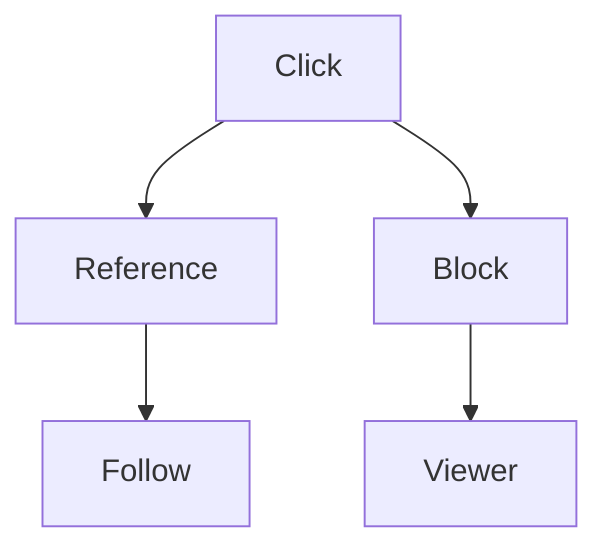

# Clicking

What a click does in Preview. Switch this note to Preview to try each line; in Source a click places the cursor and Cmd/Ctrl-click opens the link in the background.

[TOC]

## References

A click follows each of these, Cmd/Ctrl-click opens a note in the background, Shift-click extends the selection, and a right-click opens its card. Rest the mouse on one for half a second to preview it (a tag or a path has none).

- A wikilink: [[Sample deck]]
- A wikilink with its own text: [[people/Ada Lovelace|Ada's note]]
- A Markdown link: [the guide](https://mahfouz.app/guide/)
- A bare URL: https://mahfouz.app
- A tag: #kitchen-sink
- A person: @ada
- A path (desktop app): `kitchen_sink/clicking.md`

A task's assignee chip follows the same way:

- [ ] Try clicking the chip @ada // 2030-02-01

| Link in a table | Person |
|---|---|
| [[Reading list]] | @ada |

To change a link's text, choose Edit text on its card, move the cursor into it with the arrow keys, or click just beside it: [[Sample deck]].

{==This sentence links to [[Sample deck]] and has a comment.==}{>>@owahab · 2026-10-29 · A click on the link follows it; its card adds Open thread. In this comment, [[Reading list]], https://mahfouz.app, #kitchen-sink and @ada follow on click too.<<}

## Blocks

A click on the image or a diagram opens the viewer, with pan, zoom, Edit, Copy, Delete and Close. Point at a block for its toolbar, or right-click it for its menu. With the Mermaid diagrams plugin on, the Mermaid block below draws as a diagram. A click on the math block or on the Contents list above (outside an entry) shows its source.




```drawio
```

With the Draw.io diagrams plugin on, the empty draw.io block above opens its editor on a click.

$$
e^{i\pi} + 1 = 0
$$
