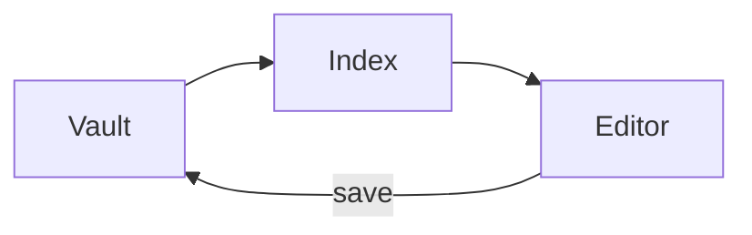

# Kitchen sink

Every Markdown feature Mahfouz supports, in one note. #kitchen-sink #reference

To try it, copy this folder (`_includes/kitchen-sink/` in the docs repository) into an empty folder and open that folder as a vault. Mahfouz offers the Mermaid and draw.io plugins the diagrams need.

[TOC]

## Inline formatting

**Bold**, _italic_, ++underline++, ~~strikethrough~~, ==highlight==, `inline code`, H~2~O (subscript), E = mc^2^ (superscript), and a literal \$5 price.

To try **Remove formatting**, select "new" in **the new** _toolbar_ and run it: the bold is split around it. Select the whole line to clear **bold**, ==highlight== and `code` while the [link](https://mahfouz.app), #kitchen-sink tag and [[Sample deck]] wikilink stay.

A [link](https://mahfouz.app), an autolink <https://docs.mahfouz.app>, a bare link https://mahfouz.app/guide/ and address ada@example.com, a wikilink to [[Sample deck]], and one through a folder with its own text: [[people/Ada Lovelace|Ada's note]].

A link whose label holds a URL goes to its destination, not the label's URL: [see https://mahfouz.app/guide/ in the docs](https://docs.mahfouz.app/guide/). A bare www.example.com and a bare someone@example.com are links too.

## Headings

### Level 3
#### Level 4
##### Level 5
###### Level 6

## Lists

- Bullet one
- Bullet two
  - Nested bullet
    - Deeper still
- Bullet three

1. First
2. Second
3. Third

- [ ] Plain checkbox
- [x] Checked checkbox
[ ] Checkbox without a bullet

## Tasks

- [ ] Ship the kitchen sink @owahab // 2030-01-14 14:00
- [/] Review code blocks #editor @owahab // 2030-01-15
- [ ] Water the plants // 2030-01-16
- [ ] Check the engine's tables @ada // 2030-01-17
- [x] Fix the toolbar @owahab // 2030-01-10 09:30

## Quotes and callouts

> A plain blockquote.
> It spans two lines.

> [!NOTE]
> A note callout.

> [!TIP]
> Press **Cmd+B** to make text bold.

> [!IMPORTANT]
> An important callout.

> [!WARNING]
> A warning callout.

> [!CAUTION]
> A caution callout.

## Code

```ts showLineNumbers
interface Note {
  id: string;
  title: string;
}

// Titles fall back to "Untitled".
const label = (note: Note): string => note.title || "Untitled";
```

```python
def greet(name: str) -> str:
    return f"Hello, {name}!"
```

```
A block with no language.
```

    An indented code block.

## Math

The area of a circle is $\pi r^2$.

$$
\int_0^1 x^2 \, dx = \frac{1}{3}
$$

## Table

| Feature | Mode | Status |
|---|:---:|---:|
| Code blocks | Preview | Done |
| Math | Both | Done |
| Tables | Preview | Done |

## Media


An image whose alt text is a URL still shows its own file:


## Diagrams



```drawio
<mxfile><diagram name="Page-1"><mxGraphModel><root><mxCell id="0"/><mxCell id="1" parent="0"/><mxCell id="2" value="Mahfouz" style="rounded=1;whiteSpace=wrap;" vertex="1" parent="1"><mxGeometry x="40" y="40" width="120" height="60" as="geometry"/></mxCell></root></mxGraphModel></diagram></mxfile>
```

## Track changes and comments

Meet on {~~Monday~>Tuesday~~}{>>@owahab · 2026-10-12<<} at {++10 am++}{>>@owahab · 2026-10-12<<}{--noon--}{>>@owahab · 2026-10-12<<}.

{==This sentence has a comment thread.==}{>>@owahab · 2026-10-12 · Is this clear enough?<<}{>>@agent · 2026-10-12 · Yes, it reads fine.<<}

## People

Ask @ada about the engine: a mention of the person in the vault's [[People]] database. Her note lists every mention of her under its text, one row per block: the quote, list item, long paragraph, heading and table row below.

> Notes from a call with @ada: the engine reads its cards in order,
> and @ada wants the **loop cards** checked before the next run.

- Send @ada the `tables.csv` export
- Mail @ada at ada@example.com, or post it at https://mahfouz.app
- Book the room for Thursday

The card reader needs a proper check before the next run. The engine reads its cards strictly in order, one at a time, so a single card punched in the wrong place sends every later result to the wrong column, and nobody notices until the printed tables disagree with the ones worked out by hand. @ada has written down, in [the run log](https://mahfouz.app), how a loop runs the same operation cards again with new variables, and _that_ is exactly where one misplaced card does the most damage. Until her steps have been read, keep each deck in its own box, label every card with the date it was punched, and don't reorder anything, however obvious the fix looks.

### Questions for @ada

| Topic | Owner | Notes |
|---|---|---|
| Card reader | @ada | Add a slide to [[Sample deck]] |
| Mill | Charles | Fine as is |

## Slides

[[Sample deck]] is a child note written as slides.

## Database

The [[Reading list]] below is a database: its rows are this note's child notes.

---

Text after a horizontal rule (also a slide break).
